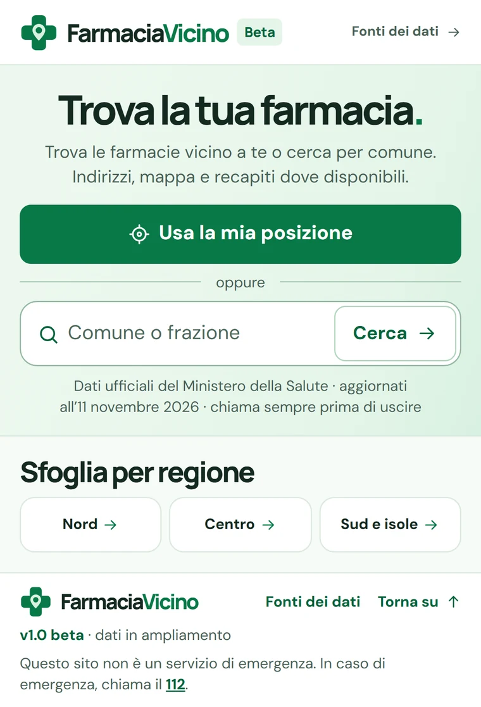
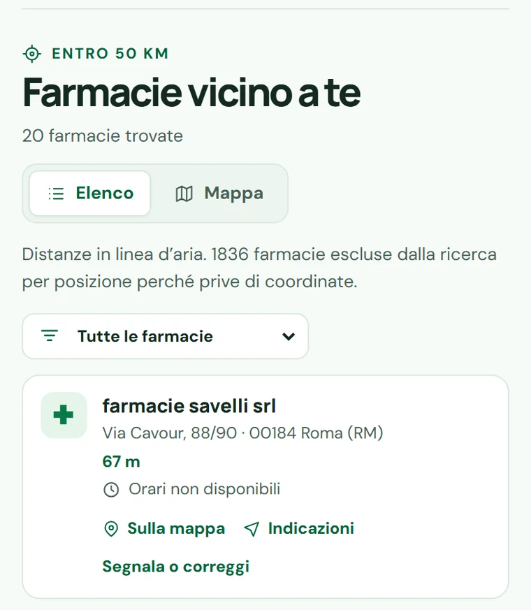
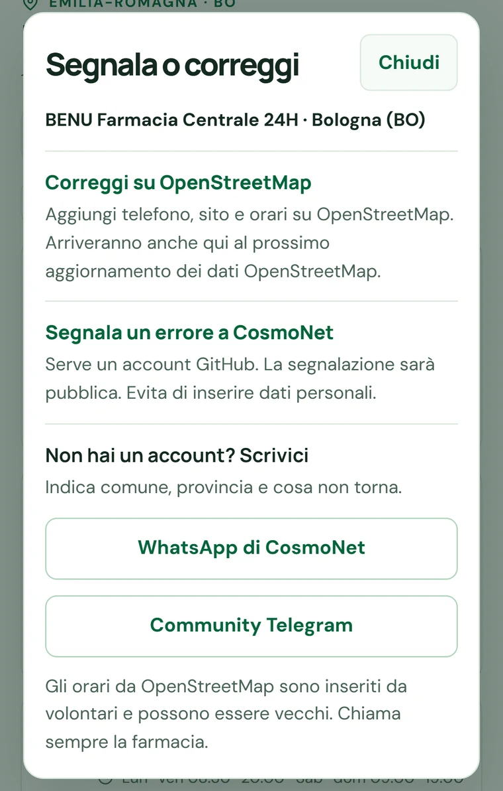
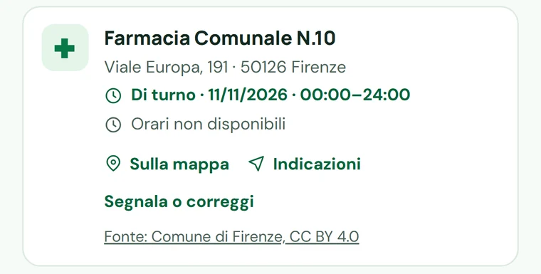

# Farmacia Vicino

**Versione 1.0 beta.** L’interfaccia è stabile e i dati sono in ampliamento.

Farmacia Vicino è una web app gratuita per trovare farmacie in Italia, cercando per comune, frazione o posizione e consultando mappa, indirizzi, orari e recapiti disponibili. Sviluppata da [CosmoNet.info](https://www.cosmonet.info/).

[Apri Farmacia Vicino](https://cosmonetinfo.github.io/Farmacia-facile-/)

> Chiama la farmacia per confermare gli orari, soprattutto nei festivi. In caso di emergenza, chiama il 112.

## Schermate

Schermate della versione pubblicata l’11 novembre 2026. La ricerca per posizione usa un punto simulato a Roma. Il turno di Firenze è un esempio datato.

| Home | Ricerca per posizione |
| --- | --- |
|  |  |

| Segnala o correggi | Farmacia di turno a Firenze |
| --- | --- |
|  |  |

## Cosa fa oggi

- **Farmacie vicino a te**: premendo «Usa la mia posizione», l’app mostra le prime 20 farmacie entro 50 km, ordinate per distanza in linea d’aria. «Mostra altre» aggiunge altri risultati. La mappa mostra i segnaposti delle farmacie e della tua posizione.
- **Ricerca per comune o frazione**, con suggerimenti mentre scrivi. Accenti e apostrofi non contano, e i comuni fusi o rinominati portano al comune attuale.
- **Navigazione per zona**: Nord, Centro, Sud e isole, poi regione, provincia e comune.
- **Elenco e mappa** (Leaflet + OpenStreetMap), sei schede per pagina, con passaggio rapido da una vista all'altra.
- **Filtri**: tutte le farmacie, con orari pubblicati, con numero di telefono, aperte 24 ore.
- **Orari del giorno** per Friuli-Venezia Giulia e Provincia autonoma di Bolzano, letti dal browser dai dati aperti regionali.
- **Farmacie di turno a Firenze**, con data e attribuzione al Comune. Il turno è indicato separatamente dagli orari di apertura.
- **Schede verificate** per cinque farmacie di Bologna e Cagliari, con link alla fonte e data del controllo.
- **Link condivisibili** per comune, provincia ed eventuale frazione. [Esempio a Spoleto](https://cosmonetinfo.github.io/Farmacia-facile-/?comune=Spoleto&provincia=PG)
- **Nessun backend e nessun account**: è un sito statico, la ricerca avviene nel browser.
- **Pannello "Fonti dei dati"** con tutte le fonti, le licenze e le date di estrazione.
- **Segnala o correggi** da ogni scheda. Puoi aprire l’editor OpenStreetMap quando è disponibile un punto, aprire un modulo GitHub precompilato o contattare CosmoNet via WhatsApp o Telegram.
- Ha manifest e icone per essere aggiunta alla schermata Home.

## Da dove arrivano i dati

| Dato | Fonte e attribuzione | Licenza o note |
| --- | --- | --- |
| Anagrafe e indirizzi delle farmacie | [Ministero della Salute, dataset Farmacie](https://www.dati.salute.gov.it/it/dataset/farmacie/) | [IODL 2.0](https://www.isprambiente.gov.it/%2B%2Bplone%2B%2Bispra.gara/iodl2.pdf). Il sito converte il CSV in JavaScript. |
| Comuni, denominazioni e fusioni | [ISTAT – SITUAS](https://situas.istat.it/web/) | [Note legali ISTAT](https://www.istat.it/note-legali/). Le frazioni ricercabili provengono dall’anagrafe delle farmacie. |
| Recapiti, orari, alcune coordinate e cartografia | [© OpenStreetMap contributors](https://www.openstreetmap.org/copyright) | [ODbL 1.0](https://opendatacommons.org/licenses/odbl/1-0/). L’estrazione abbinata è disponibile in [`docs/recapiti-osm.js`](docs/recapiti-osm.js). |
| Orari del giorno in Friuli-Venezia Giulia | [Regione Friuli-Venezia Giulia, dataset Farmacie](https://www.dati.friuliveneziagiulia.it/api/views/jbxd-m6xe.json) | IODL 2.0 |
| Orari del giorno in Provincia autonoma di Bolzano | [Provincia autonoma di Bolzano, Farmacie di turno dell’Alto Adige](https://data.civis.bz.it/dataset/farmacie-di-turno-dell-alto-adige1) | [CC0 1.0](https://creativecommons.org/publicdomain/zero/1.0/) |
| Turni del giorno nel Comune di Firenze | [Comune di Firenze, Turni Farmacie](https://opendata.comune.fi.it/page_dataset_show?id=cac33ab9-7331-4ecc-a365-712e6913da08) | [CC BY 4.0](https://creativecommons.org/licenses/by/4.0/). Il sito seleziona i record abbinati e adatta il formato degli orari. |
| Schede curate a mano | Siti ufficiali delle farmacie, indicati nel [file delle schede verificate](docs/schede-verificate.js) | Fonte e data del controllo sono visibili nelle schede. |

Per i candidati ancora in valutazione consulta la [ricognizione sulle fonti dei turni](fonti-farmacie-di-turno.md).

## Quanto sono completi i dati

Misura effettuata l’**11 novembre 2026** sui file serviti da GitHub Pages. L’anagrafe ministeriale è dell’11 novembre 2026 e l’estrazione OpenStreetMap del 10 novembre 2026.

| Dato | Farmacie | Quota sul totale |
| --- | ---: | ---: |
| Farmacie nell’anagrafe | 20.777 | 100% |
| Coordinate utilizzabili | 18.941 | 91,2% |
| Almeno un recapito, telefono o sito | 2.113 | 10,2% |
| Numero di telefono | 1.950 | 9,4% |
| Orari abituali pubblicati | 1.191 | 5,7% |
| Sito web | 817 | 3,9% |
| Almeno un dato tra telefono, sito e orari abituali | 2.380 | 11,5% |
| Record OpenStreetMap abbinato nell’estrazione | 2.376 | 11,4% |

Il denominatore è il numero di ID ministeriali distinti nel [file pubblicato](https://cosmonetinfo.github.io/Farmacia-facile-/farmacie.js). Ogni riga della tabella conta le farmacie una sola volta per categoria. Le categorie possono sovrapporsi. Per telefono, sito e orari si applica la stessa precedenza del sito tra [schede verificate](https://cosmonetinfo.github.io/Farmacia-facile-/schede-verificate.js) ed [estrazione OpenStreetMap](https://cosmonetinfo.github.io/Farmacia-facile-/recapiti-osm.js). I turni e gli orari del giorno arrivano al momento della ricerca e restano fuori da questa misura.

<details>
<summary>Ripetere la misura dalla console del browser</summary>

Apri il sito, attendi il caricamento dei dati e incolla questo codice nella console.

```js
const righe = cities.flatMap(comune => comune.pharmacies.map(riga => toPharmacy(riga, comune)))
const farmaciePerId = new Map(righe.map(farmacia => [farmacia.id, farmacia]))
const conta = test => [...farmaciePerId.values()].filter(test).length

console.table({
  anagrafe: farmaciePerId.size,
  coordinate: conta(p => p.coords?.length === 2 && p.coords.every(Number.isFinite)
    && Math.abs(p.coords[0]) <= 90 && Math.abs(p.coords[1]) <= 180),
  recapiti: conta(p => Boolean(p.info?.phone || p.info?.site)),
  telefono: conta(p => Boolean(p.info?.phone)),
  orari: conta(p => Boolean(p.info?.hours)),
  sito: conta(p => Boolean(p.info?.site)),
  telefonoSitoOOrari: conta(p => Boolean(p.info?.phone || p.info?.site || p.info?.hours)),
  abbinamentiOSM: conta(p => Boolean(window.recapitiOSM.records[p.id]))
})
```

</details>

## Limiti attuali

- La ricerca per posizione include solo le farmacie con coordinate.
- Recapiti e orari abituali sono disponibili per una piccola parte delle farmacie.
- Gli orari del giorno sono disponibili solo in Friuli-Venezia Giulia e nella Provincia autonoma di Bolzano, nella ricerca per comune.
- La ricerca per comune mostra i turni solo per Firenze e solo per le farmacie abbinate univocamente per via e civico, con riscontro sul nome. Civici rossi, multipli o assenti restano esclusi.
- La web app richiede una connessione a Internet. La modalità offline non è disponibile.
- Telefoni, siti e orari da OpenStreetMap sono abbinati alle farmacie in modo prudente: se l'abbinamento è dubbio, il dato non viene mostrato.
- Alcuni segnaposto sulla mappa possono essere approssimativi.
- I nomi arrivano dall'anagrafe e non sono ripuliti: possono contenere la forma societaria.
- Solo a Bologna le schede sono ordinate per vicinanza al centro. Altrove l'ordine è alfabetico.

## Privacy

La web app funziona nel browser, senza account, tracciamento o backend proprio. La posizione si chiede quando premi «Usa la mia posizione». Le coordinate restano nella memoria della pagina per la ricerca corrente. La web app calcola le distanze sul dispositivo e non invia le coordinate a servizi esterni, non le aggiunge all’URL e non le salva nell’archiviazione del browser.

| Servizio | Quando il browser lo contatta |
| --- | --- |
| Google Fonts | Caricamento dei caratteri della pagina. |
| `tile.openstreetmap.org` | Caricamento della cartografia nella ricerca per comune. La vista «Farmacie vicino a te» usa una griglia locale. |
| `www.dati.friuliveneziagiulia.it` | Orari del giorno per le ricerche nei comuni del Friuli-Venezia Giulia. |
| `daten.buergernetz.bz.it` | Orari del giorno per le ricerche nei comuni della Provincia autonoma di Bolzano. |
| `datigis.comune.fi.it` | Turni del giorno nella ricerca per il Comune di Firenze. |

«Indicazioni» apre Google Maps con la farmacia come destinazione. «Segnala o correggi» apre il servizio scelto dopo il clic. GitHub riceve i dati pubblici della scheda nel modulo precompilato e le segnalazioni inviate sono pubbliche. I collegamenti WhatsApp e Telegram si aprono senza testo precompilato e senza dati della farmacia nell’URL.

## Come è fatto

```
docs/                     sito statico pubblicato da GitHub Pages
  index.html, styles.css  interfaccia
  app.js                  logica di ricerca, schede e mappa
  farmacie.js             anagrafe del Ministero (generato)
  comuni.js               comuni e denominazioni ISTAT (generato)
  recapiti-osm.js         telefoni, siti e orari da OpenStreetMap (generato)
  orari-regionali.js      orari del giorno da FVG e Bolzano e turni di Firenze, letti dal browser
  schede-verificate.js    schede curate, fonti e date di verifica
  indirizzi.js            normalizzazione degli indirizzi per gli abbinamenti
  leaflet/                libreria mappe
aggiorna-dati.ps1         scarica Ministero e ISTAT e rigenera i dati
importa-farmacie.ps1      converte il CSV del Ministero in farmacie.js
importa-comuni.py         converte i dati ISTAT in comuni.js
importa-recapiti.mjs      abbina le farmacie a OpenStreetMap (estrazione Overpass)
.github/workflows/        pubblicazione su GitHub Pages e aggiornamento mensile
.github/ISSUE_TEMPLATE/   modulo di segnalazione
readme-img/              schermate del README, fuori dal sito pubblicato
```

Il sito usa HTML, CSS e JavaScript senza framework, con Leaflet per la mappa. Gli script di importazione usano PowerShell, Python e Node.js.

### Aggiornamento dei dati

Il [workflow GitHub Actions](.github/workflows/pages.yml) pubblica `docs/` su GitHub Pages dopo un push su `main` che modifica il sito o il workflow. Il primo giorno del mese e su richiesta controlla anche Ministero e ISTAT con `aggiorna-dati.ps1`. Lo script verifica che l’anagrafe ministeriale non arretri di data e che la nuova estrazione copra tutte le regioni. Il workflow controlla la sintassi JavaScript e, se i file dei dati cambiano, li salva con un commit e ripubblica.

L'estrazione di OpenStreetMap **non è ancora automatica**: l'aggiornamento mensile toglie solo i recapiti che non tornano più con la nuova anagrafe.

In locale, con PowerShell 7, Python 3 e `curl`:

```
pwsh ./aggiorna-dati.ps1
```

I recapiti da OpenStreetMap si rigenerano con un'estrazione Overpass delle farmacie italiane:

```
node importa-recapiti.mjs estrazione-overpass.json
```

### Provarlo in locale

Con Python 3 puoi servire la cartella `docs/` direttamente.

```
cd docs
python3 -m http.server 8080
```

Apri `http://localhost:8080`. La ricerca per posizione è disponibile su HTTPS e su localhost nei browser che supportano la geolocalizzazione.

## Contribuire

- **OpenStreetMap.** Apri «Segnala o correggi» sulla scheda e scegli «Correggi su OpenStreetMap» quando disponibile. Puoi correggere telefono, sito e [orari di apertura](https://wiki.openstreetmap.org/wiki/Key:opening_hours). I dati abbinati arrivano su Farmacia Vicino al prossimo aggiornamento dell’estrazione.
- **GitHub.** Usa il modulo precompilato della scheda o [apri una segnalazione](https://github.com/CosmoNetinfo/Farmacia-facile-/issues/new?template=segnalazione.yml). Indica comune, provincia, dato da correggere e fonte. Serve un account GitHub e la segnalazione è pubblica.
- **CosmoNet.** Scrivici indicando comune, provincia e cosa non torna. [WhatsApp](https://wa.me/393517064080) · [Community Telegram](https://t.me/cosmo_community1)

Un obiettivo futuro è consentire alle farmacie aderenti di comunicare direttamente recapiti e orari, con una procedura di verifica. Oggi le correzioni passano dai canali descritti sopra.

### Aggiungere una scheda verificata

Verifica nome, recapiti e orari con il titolare o sul sito ufficiale della farmacia. Aggiungi una voce a `docs/schede-verificate.js` con l’`id` numerico ministeriale, `registryAddress` copiato dall’anagrafe, `name`, `phone`, `site`, `hours` e `alwaysOpen` (un booleano). Il campo facoltativo `address` permette di usare una grafia diversa per l’indirizzo mostrato.

Indica la fonte in `sourceUrl` e la data effettiva del controllo in `verifiedOn` (formato `AAAA-MM-GG`). Usa `verifiedBy: "CosmoNet"` per una verifica redazionale e `verifiedBy: "titolare"` per una conferma diretta del titolare. Usa un solo record per ID. La scheda prevale sui recapiti OpenStreetMap se l’indirizzo continua a corrispondere all’anagrafe.

## Licenza e attribuzioni

I dati restano soggetti alle licenze delle fonti indicate sopra. In particolare i recapiti derivati da OpenStreetMap sono © OpenStreetMap contributors, ODbL 1.0.

Il codice del progetto non ha una licenza dichiarata.
